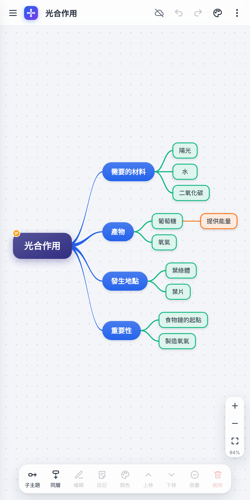

# 🧠 心智圖 App

一個可以安裝在手機和電腦上的心智圖 App。
點一下就能新增、刪除主題，依層級自動上色，有 14 種鮮豔的顏色主題，每個主題可加註記並記錄建立時間，手機和電腦可以同步使用。

**👉 立即使用：<https://chahan1.github.io/mindmap/>**



---

## ✨ 主要功能

| 功能 | 說明 |
|---|---|
| ➕ 新增 | 點選主題後，按外側藍色 **＋** 新增子主題、下方 **＋** 新增同層；鍵盤 Tab／Enter |
| ❌ 刪除 | 按主題角落的紅色 **×**，刪錯了可按「復原」 |
| ✏️ 編輯 | 點兩下主題修改文字，Shift+Enter 換行 |
| 🖐️ 整理 | 拖曳主題到另一個主題上搬移；上移／下移；摺疊分支 |
| 🎨 顏色 | 依層級自動上色；14 種顏色主題（繽紛、彩虹、霓虹、星空、海洋、熱帶、薄荷、森林、夕陽、秋楓、莓果、糖果、莫蘭迪、簡約）；也可單獨換色 |
| 📝 註記 | 每個主題都能寫註記（想法、補充、日後回饋），有註記的主題角落會出現黃色小圖示 |
| 🕒 時間 | 自動記錄每個主題的建立與修改時間；可在主題下方顯示建立時間 |
| 🗂️ 回顧 | 「回顧清單」依時間列出所有主題與註記，點一下跳到該主題，也能複製成文字 |
| ☁️ 同步 | 用 GitHub 金鑰，手機與電腦自動同步（註記和時間也會一起同步） |
| 📤 匯出 | 匯出 PNG 圖片、複製大綱文字（含註記）、下載備份檔 |
| 📥 匯入 | 貼上條列式大綱（可以請 AI 先列好）自動變成心智圖 |
| 📴 離線 | 安裝後沒有網路也能開啟和編輯，連上網路後自動同步 |

---

## 📝 註記與回顧（日後反饋）

- **寫註記**：點選主題 → 按下方工具列的「**註記**」，在右側（手機是下方）面板輸入，會自動儲存。
- **看註記**：有註記的主題左上角會出現**黃色小圖示**，點一下就能打開。
- **時間**：面板下方會顯示「建立」與「修改」時間。⋮ →「在主題下方顯示建立時間」可以直接在圖上看到。
- **回顧清單**：⋮ →「回顧清單」，可以依「新 → 舊／舊 → 新」排序、只看有註記的主題，點一下就跳過去；「複製成文字」可貼到文件或交給 AI 整理回饋。
- **大綱匯入**：在主題下一行用 `>` 開頭，就會變成那個主題的註記，例如：

  ```
  光合作用
    葉綠體
    > 學生容易和粒線體搞混
  ```

> v1.4 以前建立的主題沒有時間紀錄，會顯示「—」。

---

## 🚀 第一次安裝到 GitHub

### 步驟 1：建立新倉庫
1. 登入 <https://github.com>，按右上角 **＋** → **New repository**。
2. **Repository name** 輸入 `mindmap`（全部小寫）。
3. 選 **Public**，其他都不用勾，按 **Create repository**。

> 倉庫名稱就是網址的一部分：`mindmap` → `https://chahan1.github.io/mindmap/`

### 步驟 2：上傳檔案
1. 把 `mindmap-app.zip` 解壓縮。
2. 在新倉庫頁面點 **uploading an existing file**。
3. 把資料夾裡的**全部檔案**拖進去（`index.html`、`sw.js`、`manifest.json`、所有 `.png` 圖檔、`README.md`）。
4. 按下方綠色 **Commit changes**。

> `.nojekyll` 是隱藏檔，沒有上傳到也沒關係。

### 步驟 3：開啟 GitHub Pages
1. 進入倉庫的 **Settings** → 左邊選 **Pages**。
2. **Build and deployment** 的 **Source** 選 **Deploy from a branch**。
3. **Branch** 選 `main`、資料夾選 `/ (root)`，按 **Save**。
4. 等 1～2 分鐘，頁面上方會出現 “Your site is live at …”。

### 步驟 4：開啟 App
用瀏覽器開啟 <https://chahan1.github.io/mindmap/>。

> ⚠️ **第一次開啟請連上網路**，程式才會存到裝置裡，之後就能離線開啟。

---

## 📱 安裝到手機和電腦

| 裝置 | 安裝方式 |
|---|---|
| **Android**（Chrome） | 開啟網址 → 右上角 ⋮ →「**安裝應用程式**」或「**加到主畫面**」 |
| **iPhone／iPad**（Safari） | 開啟網址 → 下方分享按鈕 ⬆️ →「**加入主畫面**」 |
| **電腦**（Chrome／Edge） | 開啟網址 → 網址列右側的「安裝」圖示 🖥️ |

安裝後，App 會有自己的圖示，開啟時沒有網址列。

---

## 📦（選用）產生 Android APK 安裝檔

跟英語筆記本一樣，可以用 PWABuilder 包成 APK：

1. 到 <https://www.pwabuilder.com>，輸入 `https://chahan1.github.io/mindmap/`，按 **Start**。
2. 按 **Package For Stores** → **Android** → **Generate Package**。
   - 在 **Options** 裡，**Package ID** 填 `io.github.chahan1.mindmap`，**App name** 填 `心智圖`。
3. 下載 zip，裡面的 `.apk` 傳到手機安裝（需要允許「安裝不明來源的應用程式」）。
4. **讓 App 頂端不出現網址列**（Digital Asset Links）：
   - 打開下載的 zip 裡的 `assetlinks.json`，複製 `[` `]` 裡面那一段 `{ … }`。
   - 到 **`chahan1.github.io` 倉庫**（英語筆記本那個），編輯 `.well-known/assetlinks.json`。
   - 在最後一個 `}` 後面加一個逗號 `,`，再貼上剛才複製的內容，存檔（Commit）。

   完成後的樣子（第三段是心智圖，指紋要用你自己下載檔裡的）：

   ```json
   [
     { "relation": [...], "target": { "namespace": "android_app", "package_name": "io.github.chahan1.twa", ... } },
     { "relation": [...], "target": { "namespace": "android_app", "package_name": "io.github.chahan1.worklog", ... } },
     {
       "relation": ["delegate_permission/common.handle_all_urls"],
       "target": {
         "namespace": "android_app",
         "package_name": "io.github.chahan1.mindmap",
         "sha256_cert_fingerprints": ["（貼上你下載檔裡的指紋）"]
       }
     }
   ]
   ```

> 🔐 zip 裡的 `signing.keystore` 和 `signing-key-info.txt` 請妥善保存，以後要更新 APK 會用到。
> **APK 不需要每次更新都重新產生**，App 會自動顯示網站上的新版內容。

---

## ☁️ 設定手機與電腦同步

同步資料存在你 GitHub 帳號裡的一個**秘密 Gist**（名稱：「心智圖 App 同步資料（請勿刪除）」）。

**建立金鑰（只需要做一次）**
1. 在 App 按右上角**雲朵**圖示 → **建立 GitHub 金鑰**（或直接開 <https://github.com/settings/tokens/new?scopes=gist&description=心智圖同步>）。
2. **Expiration** 選 **No expiration**（或你要的期限）。
3. 權限只要勾 **gist**，按最下方 **Generate token**。
4. 複製 `ghp_` 開頭的金鑰。**金鑰只會顯示一次**，請先存在記事本或密碼管理工具。

**每台裝置設定一次**
1. 開啟 App → 按右上角雲朵 → 貼上金鑰 → **連線**。
2. 雲朵變成綠色打勾 ✅ 就代表已同步。
3. 手機和電腦都要貼**同一組金鑰**。

**同步時機**：開啟 App、切回 App 畫面、每 30 秒、每次修改後，都會自動同步。也可以按雲朵 →「立即同步」。

| 雲朵狀態 | 意思 |
|---|---|
| ✅ 綠色 | 已同步 |
| 🔵 藍色 | 同步中 |
| 🟠 橘色 | 暫時連不上，變更先存在這台裝置，連上網路會自動補上 |
| 🔴 紅色 | 金鑰無效或過期，請按雲朵重新設定 |
| ⚪ 灰色 | 尚未設定同步 |

---

## 🔄 更新程式

1. 把新版的 `index.html` 和 `sw.js` 上傳到 `mindmap` 倉庫（**Add file → Upload files**），按 **Commit changes**。
2. 等 1～2 分鐘讓 GitHub Pages 更新。
3. 開啟 App，上方會出現「已下載新版本」，按「**重新載入**」即可。

> 每次更新時，`sw.js` 第 3 行的版本號（`CACHE_NAME`）都要改，例如 `mindmap-v1.4.0` → `mindmap-v1.4.1`，裝置才會知道有新版。

---

## 🔒 資料與隱私

- 心智圖會存在**每台裝置的瀏覽器**裡；有設定同步的話，也會存在你的**秘密 Gist**。
- 這個倉庫只放程式檔案，任何人看到的都只是空白的程式。
- GitHub 金鑰只存在你自己的裝置，不會上傳到倉庫。金鑰權限只有 gist，不能動你的其他倉庫。
- 秘密 Gist 不會出現在公開列表，但**知道網址的人看得到**，請不要放敏感資料。
- 金鑰不小心外流：到 <https://github.com/settings/tokens> 刪除它，再建立一組新的。
- 心智圖 App 和英語筆記本在同一個網域，但資料各自分開存放，互不影響。

---

## 📂 檔案說明

| 檔案 | 說明 |
|---|---|
| `index.html` | 主程式（所有功能與畫面） |
| `sw.js` | Service Worker：讓 App 可以離線開啟，並負責版本更新 |
| `manifest.json` | App 設定（名稱、圖示、主題色） |
| `icon-192.png`、`icon-512.png` | App 圖示 |
| `maskable-192.png`、`maskable-512.png` | Android 圓形裁切用圖示 |
| `apple-touch-icon.png` | iPhone 主畫面圖示 |
| `screenshot-1.png`、`screenshot-2.png` | 手機／電腦畫面截圖（安裝畫面與商店展示用） |
| `.nojekyll` | 讓 GitHub Pages 直接提供檔案，不經過 Jekyll 處理 |

---

## ❓ 常見問題

**Q：開啟網址出現 404？**
剛開啟 Pages 要等 1～2 分鐘。確認 Settings → Pages 的 Branch 是 `main` / `(root)`，倉庫名稱是小寫 `mindmap`，`index.html` 在倉庫最外層（不是在資料夾裡）。

**Q：手機和電腦的內容不一樣？**
確認兩台都設定了**同一組金鑰**，雲朵是綠色。按雲朵 →「立即同步」，或把 App 切到背景再切回來。

**Q：雲朵變紅色，顯示金鑰無效？**
金鑰可能過期或被刪除。到 <https://github.com/settings/tokens> 建立新的金鑰（勾 gist），每台裝置按雲朵 →「中斷同步」→ 重新貼上新金鑰。資料還在 Gist 裡，不會不見。

**Q：兩台裝置同時改同一張心智圖會怎樣？**
以「最後修改」的那一份為準。建議一次在一台裝置上編輯，改完等雲朵變綠色再換裝置。

**Q：上傳新版後還是舊版？**
確認 `index.html` 和 `sw.js` 都有上傳，而且 `sw.js` 的版本號有改。連網開啟 App 一兩次，等出現「重新載入」提示。

**Q：claude.ai 上的心智圖可以搬過來嗎？**
可以。在 claude.ai 版按 ⋮ →「備份」→ 複製或下載；到這個 App 按 ⋮ →「匯入」→ 貼上或選擇檔案。

**Q：在 LINE、Facebook 裡打開網址，不能安裝？**
請改用 Chrome（Android）或 Safari（iPhone）開啟。

---

## 📜 版本紀錄

| 版本 | 更新內容 |
|---|---|
| v1.4.0 | 主題註記、建立／修改時間、回顧清單；顏色主題增加到 14 組並更鮮豔；＋／× 按鈕跟著縮放 |
| v1.3.0 | 可安裝成 App（PWA）、離線開啟、新版本提示 |
| v1.2 | 7 種顏色主題、版面美化、畫面上直接刪除（可復原）、GitHub Gist 同步、縮放按鈕 |
| v1.1 | 依層級自動上色、畫面上直接新增主題 |
| v1.0 | 初版：新增／編輯／拖曳搬移、摺疊、匯出 PNG、大綱匯入匯出、多張心智圖 |

---

## 🛠 技術說明

- 純 HTML／CSS／JavaScript 單一檔案，不需要建置工具、不需要任何外部函式庫
- 畫面：SVG 自動排版（左右平衡或全部向右）
- 資料儲存：`localStorage`（每台裝置）＋ GitHub Gist API（同步）
- 離線：Service Worker（網頁本體優先連網、圖示優先快取）
- 部署：GitHub Pages；Android 安裝檔由 PWABuilder（Trusted Web Activity）產生
